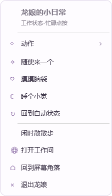
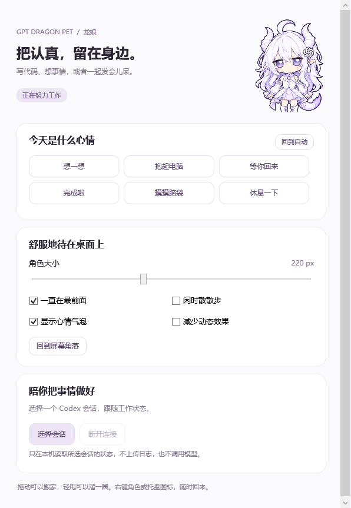

# 龙娘 · GPT Dragon Pet

一只白发紫瞳的小龙娘，陪你写代码，也陪你偶尔发呆。


Windows 白龙娘桌宠，提供 Codex 本地插件入口，重点参考 [PC2005-cloud/dsh-pet](https://github.com/PC2005-cloud/dsh-pet) 的交互和动作组织，使用自己的白龙娘素材，不依赖 DeepSeek Harness。

## 0.2 更新

- 右键菜单改为圆角浅紫面板，按「动作 → 分类 → 具体动作」组织，包含 13 类、106 个动作入口。
- 64 张有体积光影的角色姿态组成 16 个基础循环；眨眼、呼吸、转身、表情、睡觉、伸懒腰、跳舞、行走与奔跑搭配程序运动。
- 五种点击回应轮换，避免连续重复；闲时按权重选择小动作、玩耍和吃东西，支持关闭随机动作。
- 鼠标与窗口运动由原生 WPF 渲染循环处理，拖拽、甩抛、碰壁和落地回弹不再逐帧经过 Node.js 与 PowerShell 通信。
- 工作间支持尺寸、置顶、散步、气泡、减少动态效果及所选 Codex 会话联动。

0.2.1 新增预加载自动跟随：Codex 窗口重开、恢复时复用已经加载的龙娘窗口；关闭或最小化全部 Codex 窗口时隐藏角色。检测通过本地窗口事件与低频兜底检查完成，不依赖聊天加载 MCP。原生代码按源文件和运行环境缓存编译结果，日常启动复用缓存。

**素材边界：106 个入口使用基础姿态、程序运动和独立道具组合，并非 106 段独立制作的完整视频。人物是有立体光影的二维精灵，不是可自由旋转的 3D 模型。** 鲸鱼娘原项目的视频演出更细腻；本项目保留相应动作主题，以龙娘素材重新实现。逐项映射见 [动作目录](docs/ACTIONS.md)。



## 作为 Codex 插件使用

需要 Windows 10/11、Codex 桌面应用与 Node.js 24+。在项目目录运行：

```powershell
npm run install:plugin
```

也可以双击 `安装龙娘插件.cmd`。安装程序只注册本项目的本地插件来源和插件，运行路径保存在忽略的 `.mcp.json` 中，不创建开机启动项、计划任务或系统环境设置。使用 Codex 兼容插件清单格式，与现有 GPT娘挂件采用相同的本地安装机制。

插件名称为「白龙娘桌宠」，ID 为 `gpt-dragon-pet@gpt-dragon-local`。安装后，由 Codex 在会话加载本地 MCP 服务时启动角色；已打开的会话可能需要重新进入才能载入新插件。**安装登记完成不等于当前会话已经加载服务。** 不需要打开网页、设置页或独立程序主界面。

角色与设置窗口都不出现在 Windows 任务栏；插件和自动跟随模式也不显示独立托盘图标。右键角色可打开设置和退出。多个插件连接共享同一只桌宠；未启用自动跟随时，插件服务全部断开后退出由插件启动的桌宠，崩溃连接最多等待约 12 秒。主动退出角色后，调用「显示白龙娘桌宠」可以重新显示。

插件提供显示、状态查询和隐藏三个工具，不自动选择其他聊天、不增加模型请求。设置入口只在明确要求打开时显示。现有的 GPT娘额度插件保持独立。

移除本项目插件：

```powershell
codex plugin remove gpt-dragon-pet@gpt-dragon-local
codex plugin marketplace remove gpt-dragon-local
```

移除插件保留项目文件与 `.state/` 中的个人偏好。GitHub 仓库只是源码存储，并未发布到公共插件目录。

## 快速跟随 Codex

```powershell
npm run follow:start
npm run follow:status
```

启动后，跟随器在本次 Windows 登录期间保持预加载。检测到 Codex 桌面主窗口才显示角色；最小化、关闭全部主窗口时隐藏，重新打开时直接恢复。它只检查窗口类型、可见性和对应程序路径，不读取窗口标题或聊天正文。只识别 OpenAI Codex 安装目录里的桌面程序，不跟随浏览器或命令行 Codex。

右键「退出龙娘」或 `npm run follow:stop` 会暂停跟随，新聊天加载插件不会自行唤醒。`npm run follow:start` 或插件的显示工具可明确恢复。跟随开启期间，MCP 断开不会结束跟随器。

如果希望重启电脑后仍自动跟随，需要明确启用当前用户登录启动项：

```powershell
# 先查看将写入的位置，不做改动
powershell.exe -NoProfile -ExecutionPolicy Bypass -File scripts/follow-control.ps1 -Action EnableStartup -CheckOnly
# 用户同意后启用
powershell.exe -NoProfile -ExecutionPolicy Bypass -File scripts/follow-control.ps1 -Action EnableStartup
# 撤销并停止跟随，保留项目和设置
powershell.exe -NoProfile -ExecutionPolicy Bypass -File scripts/follow-control.ps1 -Action DisableStartup
```

启用只在当前用户的 Startup 文件夹创建 `GPT Dragon Pet.lnk`，指向本项目 `follow-codex.vbs`；不需要管理员权限。普通插件安装与 `follow:start` 不创建这个启动项。项目移动后需重新指定启动项；禁用操作只移除指向本项目的快捷方式。登录启动尊重主动退出后的暂停状态，可随时明确恢复。

## 独立运行

也保留原来的源码启动方式：

```powershell
npm start
```

使用 Windows 自带 WPF 和 Node.js，无需 Electron 或 npm 依赖。双击 `启动龙娘.vbs` 可隐藏命令窗口启动；`启动龙娘.cmd` 可查看错误。`安装依赖.cmd` 只检查 Node.js 并准备本地参考物理模块，不安装系统组件。

无需管理员权限，没有自动启动项。独立模式可使用角色右键菜单或系统托盘退出。

## 操作

| 操作 | 效果 |
| --- | --- |
| 点击角色 | 开心、害羞、傲娇、挠痒或挥手回应 |
| 按住拖动 | 弹簧跟手、悬空摇摆；快速甩出后惯性反弹 |
| 右键 → 动作 | 按分类选择具体动作 |
| 右键 → 随便来一个 | 播放一个随机动作 |
| 右键 → 回到自动状态 | 恢复会话联动与闲时动作 |
| 双击托盘图标 | 打开工作间 |
| 工作间 → 选择会话 | 连接一个明确选择的 Codex 会话 JSONL 文件 |

手动动作在播放期间优先于会话状态；「睡个小觉」持续到手动唤醒。轻放后停在当前位置，甩抛会落到屏幕底部。「闲时散散步」控制自动移动，仍可从动作菜单主动播放移动动作。

透明部分穿透鼠标，角色按当前不透明像素接收点击；支持单实例、位置记忆、跨屏拖动及负坐标。甩抛限制在当前屏幕工作区。

## 数据与边界

设置、位置和本地运行状态保存在 `.state/`，不进入 Git；构建和检查文件在 `.generated/` 与 `work/`。会话连接只允许 Codex `sessions/` 或 `archived_sessions/` 内明确选择的 JSONL 文件；有限大小增量读取，按结构化事件判断状态，不另存或上传聊天正文。

不读取凭据、不发起模型请求、不修改 Codex 设置、不监听网络端口。插件控制使用项目内的短期命令文件和连接心跳，不传输聊天正文。日志不可用时显示未连接。首次启动没有默认会话，每台电脑需自行选择。菜单中的「余额档位」仅预览动作，不读取或表示真实余额。

## 开发与检查

```powershell
npm test
npm run smoke
npm run test:follow
```

Node 检查覆盖插件协议、连接清理、控制命令白名单、动作目录、随机动作限制、偏好过滤、事件解析、所选会话边界及手动动作优先级。原生冒烟检查会创建实际 WPF 窗口，加载 64 帧、渲染全部 106 个动作道具、验证透明命中、任务栏隐藏、尺寸控制、拖拽跟踪与甩抛落地，输出截图及报告到 `work/qa/`。

自动跟随检查使用本项目创建的测试窗口，验证首次显示、最小化、恢复、关闭和重开，不操作用户的 Codex 窗口。开发机器的一次检查中，预加载窗口恢复为 29 ms、重开为 39 ms；缓存原生程序集加载为 69 ms。这些是测试窗口的本机测量，包含首次启动、图集加载在内的完整启动会更慢，不能用它们保证所有机器或实际 Codex 启动时间。

0.2 在开发机器的一次原生检查中测得约 165 次/秒渲染回调、P95 间隔 6.7 ms；这是该机器上的窗口渲染测量，不代表姿态图拥有 165 帧/秒，也不保证其他设备达到相同结果。当前提供源码启动方式，尚无免 Node.js 安装包。



## 许可

代码采用 MIT。角色图片及派生素材沿用来源素材的非商业使用范围，不属于代码 MIT 授权。完整来源见 [第三方声明](THIRD_PARTY_NOTICES.md)，生成规格见 [素材记录](assets/GENERATION.md)。

## 当前素材状态

0.2 的插件、原生拖拽和动作菜单已通过本地检查。新版角色图集仍是预览素材，透明边缘存在生成杂点，尚未完成最终视觉验收；角色更精细的动作与完整视频仍有差距。不要将 106 个组合动作入口理解为 106 段独立视频。
